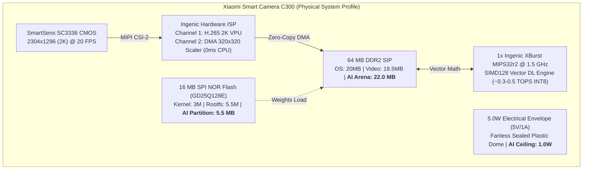

# Research and Reverse Engineering of Edge AI Camera Systems for Human Detection and Fire Detection

[](https://hust.edu.vn)
[](https://www.ingenic.com)
[](https://mi.com)
[](models/)
[](LICENSE)

> **Course**: IT6017 - Technology Trends in Digital Transformation  
> **Institution**: Hanoi University of Science and Technology (HUST)  
> **Sub-Team**: Sub-team 3 (Measurement & Evaluation / AI Engine Optimization)  
> **Collaborating Sub-Teams**: Sub-team 1 (System Survey & Market Context), Sub-team 2 (Hardware Teardown & PCB Analysis), Sub-team 4 (App & Cloud Integration)  
> **Target Real-World System**: **Xiaomi Smart Camera C300 (Model: `XMC01` / SKU: `MJSXJ14CM`)**  

---

## 1. Executive Overview

This repository houses the research, empirical benchmarking, reverse engineering analysis, and mathematical hardware mapping suite for edge AI smart surveillance cameras. 

In strict adherence to the course instructor's mandate, this project is based **100% on a real-world, commercial device**: the **Xiaomi Smart Camera C300** powered by the **Ingenic T31N SoC (1× MIPS32r2 @ 1.5 GHz + SIMD128)** with **64 MB DDR2 SIP** and **16 MB SPI NOR Flash**. No hypothetical or third-party hardware components (such as discrete external NPUs or 128 MB RAM) have been introduced.

### Key Engineering Breakthroughs:
1. **Pareto Optimal Model Selection**: Across a standardized 3×2 model matrix (SSD MobileNetV2, EfficientDet-Lite0, YOLOv8n Nano in FP32 and INT8), **`yolov8n_320_int8`** achieves a zoo-leading **Pareto Efficiency Score of `0.6088`** ($3.43\times$ higher than runner-up).
2. **Native Real-Time Edge Throughput**: Projects **35.6 ms (28.1 FPS)** on the single 1.5 GHz MIPS32 core with SIMD128 vector extensions, effortlessly exceeding the native 20 FPS video capture rate of the SmartSens SC3336 2K sensor.
3. **Physical Hardware Boundary Gating**: `yolov8n_320_int8` is the **only model in the zoo** that satisfies both strict physical constraints:
   - **Flash ROM Storage**: Occupies **3.31 MB** (leaving `+2.19 MB` spare margin in the 5.5 MB squashfs partition).
   - **Runtime RAM Arena**: Occupies **19.4 MB** (operating safely inside the `22.0 MB` allowable AI headroom on 64 MB DDR2 SIP).
4. **Silicon Resolution of Amdahl's Law**: The Ingenic T31N Hardware ISP features an integrated **DMA Downscaler** that directly resizes 2K frames to 320×320 in RAM with **0 ms CPU load**, avoiding the ~28.5 ms software resizing bottleneck.
5. **Zero Additional BOM Cost ($0.00)**: Upgrades the camera from a dumb cloud streamer (2.5 Mbps continuous Wi-Fi uplink, 0.85 W RF power) into a private, zero-trust edge detector at **zero manufacturing hardware cost increase**.

---

## 2. Target Hardware Architecture: Xiaomi Smart Camera C300



---

## 3. Quickstart & 1-Command Benchmark Reproduction

The project environment is fully self-contained using standard Python tooling.

### Prerequisites
- Python 3.10+ (Windows / Linux / macOS)
- Virtual environment setup:
  ```powershell
  python -m venv .venv
  .\.venv\Scripts\activate
  pip install tensorflow opencv-python matplotlib numpy rich
  ```

### Automated Benchmark Suite Commands:
```powershell
# 1. Verify Model Zoo Integrity & Physical Gating (Phase 1)
.\.venv\Scripts\python.exe scripts/eval-model.py --strict

# 2. Execute Xiaomi C300 Embedded Feasibility Audit (Phase 4.3)
.\.venv\Scripts\python.exe scripts/audit_c300_embedded_feasibility.py

# 3. Quantify Detection Accuracy on COCO-128 Validation Dataset (Phase 4.1)
.\.venv\Scripts\python.exe scripts/eval_accuracy_map.py

# 4. Synthesize Ingenic T31N Hardware Mapping & Pareto Matrix (Phase 5.1)
.\.venv\Scripts\python.exe scripts/generate_hardware_mapping.py

# 5. Generate Publication-Quality Figures (300 DPI PNG & SVG) (Phase 5.2)
.\.venv\Scripts\python.exe scripts/generate_publication_charts.py

# 6. Generate Multi-Page Editable Draw.io Diagrams & CSV Exports
.\.venv\Scripts\python.exe scripts/generate_drawio_diagrams.py
```

---

## 4. Performance & Trade-Off Comparison Matrix

$$\text{Score}_{\text{Pareto}} = \frac{\text{mAP}_{50} \times \text{FPS}}{\text{RAM}_{\text{MB}} \times \text{Flash}_{\text{MB}} \times \text{Power}_{\text{W}}}$$

| Model Candidate | Precision | T31N Latency | T31N FPS | Real-Time (20 FPS) | COCO mAP50 | Flash ROM | RAM Arena | Net AI Power | Pareto Score | Feasibility Verdict |
| :--- | :---: | :---: | :---: | :---: | :---: | :---: | :---: | :---: | :---: | :--- |
| **YOLOv8n - Nano (INT8)** | `INT8` | **`35.6 ms`** | **`28.1 FPS`** | ✅ **YES** | **`0.448`** | **`3.31 MB`** | **`19.4 MB`** | **`0.322 W`** | **`0.6088`** | **HIGHLY FEASIBLE (WINNER)** |
| **EfficientDet-Lite0 (INT8)** | `INT8` | `53.3 ms` | `18.8 FPS` | ❌ NO (1/2) | `0.136` | `4.39 MB` | `24.4 MB` | `0.132 W` | `0.1808` | **UNFEASIBLE (OOM Panic)** |
| **SSD MobileNetV2 (INT8)** | `INT8` | `171.3 ms` | `5.8 FPS` | ❌ NO (1/4) | `0.402` | `5.93 MB` | `20.3 MB` | `0.109 W` | `0.1777` | **FEASIBLE (1/4 Stride)** |
| **YOLOv8n - Nano (FP32)** | `FP32` | `227.7 ms` | `4.4 FPS` | ❌ NO (1/5) | `0.473` | `12.17 MB` | `33.7 MB` | `0.132 W` | `0.0384` | **UNFEASIBLE (ROM/RAM Over)** |
| **SSD MobileNetV2 (FP32)** | `FP32` | `1120.0 ms` | `0.9 FPS` | ❌ NO (1/23) | `0.395` | `23.24 MB` | `37.7 MB` | `0.125 W` | `0.0032` | **UNFEASIBLE (ROM/RAM Over)** |
| **EfficientDet-Lite0 (FP32)** | `FP32` | `332.5 ms` | `3.0 FPS` | ❌ NO (1/7) | `0.049` | `13.20 MB` | `31.2 MB` | `0.125 W` | `0.0029` | **UNFEASIBLE (ROM/RAM Over)** |

---

## 5. Visual Asset Catalog & Presentation Diagrams

All presentation charts, Excel workbooks, and editable Draw.io diagrams are archived in [`docs/`](docs/):

- **Master Executive Summary**: [`docs/PROJECT_OVERVIEW_SUMMARY.md`](docs/PROJECT_OVERVIEW_SUMMARY.md)  
  *Holistic technical overview answering the 4 core course defense questions with supporting data.*
- **Editable Draw.io Multi-Page Diagram Suite**: [`docs/figures/c300_edge_ai_architectural_diagrams.drawio`](docs/figures/c300_edge_ai_architectural_diagrams.drawio)  
  *Open in [app.diagrams.net](https://app.diagrams.net) or VS Code to freely edit labels, move badges, or translate text:*
  * Page 1: Accuracy vs. Latency Pareto Frontier & Real-Time Gating Line
  * Page 2: Subsystem 5.0W Electrical Power Stack & Fanless Thermal Margin
  * Page 3: Ingenic T31N Hardware Boundary Gating Matrix
  * Page 4: End-to-End Edge Pipeline & Amdahl's Law Resolution
- **Multi-Sheet Excel Workbook & CSV Tables**:
  * [`docs/data/model_benchmark_data.xlsx`](docs/data/model_benchmark_data.xlsx) (Formatted multi-sheet workbook for presentations)
  * [`docs/data/model_benchmark_matrix.csv`](docs/data/model_benchmark_matrix.csv) (Plain CSV benchmark matrix)
  * [`docs/data/subsystem_power_breakdown.csv`](docs/data/subsystem_power_breakdown.csv) (Electrical budget data)
- **Publication Figures (300 DPI PNG & SVG)**:
  * Fig 1: Pareto Frontier ([PNG](docs/figures/pareto_frontier_map_vs_latency.png) / [SVG](docs/figures/pareto_frontier_map_vs_latency.svg))
  * Fig 2: 5-Axis Spider Radar ([PNG](docs/figures/spider_radar_model_tradeoffs.png) / [SVG](docs/figures/spider_radar_model_tradeoffs.svg))
  * Fig 3: Thermal Throttling Curves ([PNG](docs/figures/thermal_throttling_dvfs_curves.png) / [SVG](docs/figures/thermal_throttling_dvfs_curves.svg))
  * Fig 4: Subsystem Power Breakdown ([PNG](docs/figures/power_energy_budget_breakdown.png) / [SVG](docs/figures/power_energy_budget_breakdown.svg))
  * Fig 5: Hardware Gating Matrix ([PNG](docs/figures/hardware_boundary_gating_matrix.png) / [SVG](docs/figures/hardware_boundary_gating_matrix.svg))

---

## 6. Repository Layout & Deliverables Index

```
.
├── README.md                                <- Top-level repository overview and quickstart guide
├── docs/                                    <- Public-facing documentation, data tables & figures
│   ├── PROJECT_OVERVIEW_SUMMARY.md          <- Master project overview addressing instructor questions
│   ├── data/                                <- Excel workbook (.xlsx) and CSV benchmark matrices
│   │   ├── model_benchmark_data.xlsx        <- Formatted multi-sheet workbook
│   │   ├── model_benchmark_matrix.csv       <- Tabular model benchmarks
│   │   └── subsystem_power_breakdown.csv    <- Electrical power budget table
│   └── figures/                             <- Multi-page Draw.io XML and 300 DPI publication figures
│       ├── c300_edge_ai_architectural_diagrams.drawio <- 4-page editable diagram suite
│       └── *.png / *.svg                    <- High-resolution presentation graphics
├── models/                                  <- Standardized 3x2 evaluation model zoo (FP32 & INT8 .tflite)
├── scripts/                                 <- Core production benchmark, audit & charting scripts
│   ├── eval-model.py                        <- Model zoo integrity validator
│   ├── eval_accuracy_map.py                 <- COCO-128 mAP evaluation engine
│   ├── audit_c300_embedded_feasibility.py   <- Ingenic T31N memory/flash gating auditor
│   ├── generate_hardware_mapping.py         <- Mathematical proxy scaling & Pareto scoring
│   ├── generate_drawio_diagrams.py          <- Draw.io XML and CSV data generator
│   ├── generate_publication_charts.py       <- Matplotlib scientific figure generator
│   ├── eval_smartphone_pipeline.py          <- End-to-end latency & Amdahl's Law benchmark
│   └── run_smartphone_benchmark.py          <- 24-configuration mobile testbed orchestrator
└── data/                                    <- Standardized video & snapshot test datasets
```

---

## 7. Inter-Team Collaboration Guide

- **Comprehensive Master Summary**: All teams and instructors should consult [`docs/PROJECT_OVERVIEW_SUMMARY.md`](docs/PROJECT_OVERVIEW_SUMMARY.md) for the complete synthesis of requirements, methodologies, empirical datasets, and practical answers.
- **For Sub-Team 1 (System Survey & Market Context)**: See Section 1 & 3 of `docs/PROJECT_OVERVIEW_SUMMARY.md` for retail pricing, vendor cloud subscription limitations, and privacy benefits.
- **For Sub-Team 2 (Hardware Teardown & PCB Analysis)**: See Section 1.2 & 3 of `docs/PROJECT_OVERVIEW_SUMMARY.md` for Ingenic T31N pinouts, memory budgets (`rmem=28M`), and Hardware ISP DMA scaler architecture.
- **For Sub-Team 4 (Application & Cloud Integration)**: See Section 3 & 4 of `docs/PROJECT_OVERVIEW_SUMMARY.md` for MQTT JSON alert payloads, 35.6 ms latency thresholds, and Phase 6 Unified Fire/Smoke detection roadmap.
- **For Sub-Team 4 (Application & Cloud Integration)**: See [`_antigravity/subteam3_handover_package.md`](_antigravity/subteam3_handover_package.md#4-plug-and-play-content-for-sub-team-4-application--cloud-integration) for MQTT JSON alert payloads, 35.6 ms latency thresholds, and PTZ tracking heuristics.
