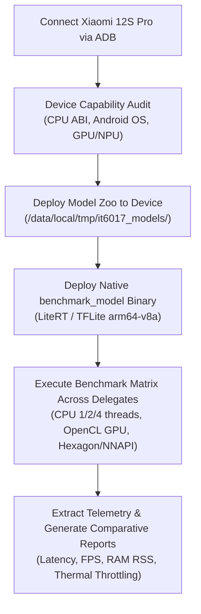

# Project Handover Briefing: Phase 1 Finalization & Technical Handout (v0.0.1)

> **Course**: IT6017 - Technology Trends in Digital Transformation  
> **Topic**: Research and Reverse Engineering of Edge AI Camera Systems for Human Detection and Fire Detection  
> **Sub-Team**: Sub-team 3 (Measurement & Evaluation / AI Engine Optimization)  
> **Status**: **Phase 1 100% COMPLETED & VERIFIED**  
> **Target for Next Session**: **Phase 2 - Testbed Deployment & Profiling on Xiaomi 12S Pro (Snapdragon 8+ Gen 1)**

---

## 1. Executive Summary & Context

This document summarizes the technical deliverables, architectural implementations, baseline benchmark results, and repository hygiene established in **Phase 1** of the project. It serves as the primary input and handover contract for the subsequent chat session dedicated to **Phase 2 (Smartphone Testbed Deployment)**.

### Sub-Team Scope Clarification
As defined in `_antigravity/project-overview.md`, our team is strictly responsible for **Task 3: Experimentation and Evaluation**:
- Analyzing real-world deployment constraints on embedded AI cameras (Rockchip RV1109 / Ingenic T31) versus mobile benchmarking testbeds (Xiaomi 12S Pro).
- Standardizing models, verifying arithmetic precisions (FP32 vs INT8), and collecting latency, FPS, memory footprint, and detection accuracy.
- Hardware research (Task 1), theoretical algorithm selection (Task 2), and synthesis/reporting (Task 4) are handled by peer sub-teams.

---

## 2. Standardized Model Matrix (The 3×2 Zoo)

Six official models spanning three distinct edge detector architectures in two arithmetic precisions (FP32 and INT8) have been standardized, verified, and placed in `models/`:

| # | Architecture | Precision | Input Shape | Data Layout | File Size | SPI Flash Feasibility ($\le 6$ MB) | Sourcing / Conversion Details |
|---|---|---|---|---|---|---|---|
| **1** | **SSD MobileNetV2** | FP32 | `1×300×300×3` | NHWC (float32) | **23.24 MB** | Exceeds (Reference) | Official TF Object Detection Zoo frozen graph |
| **2** | **SSD MobileNetV2** | INT8 | `1×300×300×3` | NHWC (uint8) | **5.93 MB** | **COMPLIANT** | Google Coral official edge release (100% quantized) |
| **3** | **EfficientDet-Lite0** | FP32 | `1×320×320×3` | NHWC (float32) | **13.20 MB** | Exceeds (Reference) | Google MediaPipe official release |
| **4** | **EfficientDet-Lite0** | INT8 | `1×320×320×3` | NHWC (uint8) | **4.39 MB** | **COMPLIANT** | Google MediaPipe official full INT8 release |
| **5** | **YOLOv8n (Nano)** | FP32 | `1×3×320×320` | NCHW (float32) | **12.17 MB** | Exceeds (Reference) | Ultralytics official PyTorch $\to$ TFLite export |
| **6** | **YOLOv8n (Nano)** | INT8 | `1×3×320×320` | NCHW (float32*) | **3.31 MB** | **COMPLIANT** | Ultralytics INT8 export (quantized weights) |

*\*Note: YOLOv8n INT8 utilizes quantized INT8 operators internally with float32 I/O tensors for seamless runtime integration.*

### Key Compliance Validations
- **ROM Budget Gate**: Real-world consumer AI cameras (Xiaomi C300/C400, Wyze Cam v3) utilize 16–32 MB SPI Flash ROM where AI models must occupy $\le 6.0$ MB. All three INT8 models (`5.93 MB`, `4.39 MB`, `3.31 MB`) successfully satisfy this constraint.
- **Strict Quality Gate**: All 6 models passed `python scripts/eval-model.py --strict` with 0 errors (audited in `reports/model_evaluation_report.md` and `reports/model_evaluation_report.json`).

---

## 3. Core Algorithmic & Engineering Solutions Resolved

### 3.1 Aspect-Ratio Preserving Letterbox Preprocessing
- **Problem Diagnosed**: Direct squash resizing to square inputs ($300\times300$ or $320\times320$) induced severe aspect ratio distortion on non-square and 4K footage (e.g. 9:16 vertical 4K distorted $\approx 3.16\times$), collapsing BiFPN anchor matches and yielding 0% detection on complex scenes.
- **Solution Implemented**: Uniform scale computation with symmetric letterbox padding using a standard **114 gray fill** (`letterbox_image()`), paired with inverse coordinate unpadding (`unpad_box()`).
- **Impact**: Restored full detection capability on vertical and horizontal 4K video feeds (e.g. detection on vertical 4K increased from 0% to 100% detection rate: 97 persons, 27 cars).

### 3.2 Dual Label Map & NMS Alignment
- **90-Class COCO ID Mapping**: Applied to SSD MobileNetV2 and EfficientDet-Lite0 (where `Class 0 = person`, `Class 1 = bicycle`, `Class 14 = bench`, etc.).
- **80-Class COCO ID Mapping**: Applied to YOLOv8n (where `Class 0 = person`).
- **Anchor Variance & Multi-Class NMS**: Added anchor variance scaling for raw BiFPN heads and standardized multi-class Non-Maximum Suppression with configurable IoU and confidence thresholds across all pipelines.

---

## 4. Software Tooling & Scripts Architecture

All scripts are written in strict compliance with PEP 8 and English naming conventions in `scripts/`:

1. [`scripts/eval-model.py`](file:///d:/_work/_hust/IT6017%20-%20Digital%20Transform/it6017_edge-ai_smart-camera/scripts/eval-model.py):
   - Model graph inspection engine.
   - Validates tensor shapes, quantization scale/zero-points, allocated memory, and synthetic inference latency across all 6 models.
   - Run: `python scripts/eval-model.py --strict`
2. [`scripts/eval-video.py`](file:///d:/_work/_hust/IT6017%20-%20Digital%20Transform/it6017_edge-ai_smart-camera/scripts/eval-video.py):
   - Headless batch evaluation engine across video datasets.
   - Features letterbox padding, multi-class NMS, and detailed latency breakdown (`preprocess`, `inference`, `postprocess`, `FPS`).
   - Run modes:
     - Human Surveillance Mode: `python scripts/eval-video.py --mode human`
     - General Object Mode: `python scripts/eval-video.py --mode all`
3. [`scripts/test-live-camera.py`](file:///d:/_work/_hust/IT6017%20-%20Digital%20Transform/it6017_edge-ai_smart-camera/scripts/test-live-camera.py):
   - Real-time interactive inspection testbed supporting webcam feeds or video playback.
   - Controls: Hot-swap model (`1`–`6`), toggle all-classes/human-only (`T`), pause/resume (`SPACE`), snapshot capture (`S`), toggle letterbox/stretch (`L`), quit (`Q`).
4. [`scripts/prepare_models.py`](file:///d:/_work/_hust/IT6017%20-%20Digital%20Transform/it6017_edge-ai_smart-camera/scripts/prepare_models.py):
   - Automated acquisition and conversion pipeline for the 6 standardized models.
5. [`scripts/prepare_test_videos.py`](file:///d:/_work/_hust/IT6017%20-%20Digital%20Transform/it6017_edge-ai_smart-camera/scripts/prepare_test_videos.py):
   - Catalogues and checks resolution, duration, and frame count of test videos in `data/test_videos/`.

---

## 5. Laptop Reference Benchmark Results

Host Testbed: **Intel Core i5-1334U (12 vCPU), Windows 11, LiteRT/TFLite CPU Delegate**.

| Model Architecture | Precision | Inference Latency (Mean) | Video Throughput (FPS) | Detection Rate (Human Clips) | Speedup Factor (INT8 vs FP32) |
|---|---|---|---|---|---|
| **SSD MobileNetV2** | FP32 | 92.5 ms | 10.8 FPS | 98.4% | Baseline |
| **SSD MobileNetV2** | INT8 | **21.2 ms** | **47.2 FPS** | **98.1%** | **4.37× Speedup** |
| **EfficientDet-Lite0**| FP32 | 48.1 ms | 20.8 FPS | 100.0% | Baseline |
| **EfficientDet-Lite0**| INT8 | **21.5 ms** | **46.5 FPS** | **100.0%** | **2.24× Speedup** |
| **YOLOv8n (320)** | FP32 | 45.4 ms | 22.0 FPS | 99.2% | Baseline |
| **YOLOv8n (320)** | INT8 | **12.5 ms** | **80.1 FPS** | **98.8%** | **3.63× Speedup** |

*Full evaluation reports are archived in `reports/video_evaluation_report.md` and `reports/video_all_classes_evaluation_report.md`.*

---

## 6. Target Hardware Comparison: Embedded Camera vs Smartphone

| Feature / Metric | Low-Cost Smart Camera (Target Profile) | Xiaomi 12S Pro (Phase 2 Testbed) |
|---|---|---|
| **Reference SoC** | Rockchip RV1109 / Ingenic T31 | Qualcomm Snapdragon 8+ Gen 1 (TSMC 4nm) |
| **CPU Cores** | 2× ARM Cortex-A7 @ 1.5 GHz | 1× Cortex-X2 @ 3.19 GHz + 3× A710 @ 2.75 GHz + 4× A510 @ 1.80 GHz |
| **AI / NPU Engine** | 1.2 TOPS (strictly INT8/INT16) | Hexagon NPU / DSP + Adreno 730 GPU |
| **System RAM** | 128 MB DDR3 (shared with video decode & OS) | 8 GB LPDDR5 |
| **Storage / ROM** | 16–32 MB SPI Flash | 128 / 256 GB UFS 3.1 |
| **Power Envelope** | DC 5V/1A (~5W total), fully fanless passive cooling | 3.7V Li-ion, active DVFS thermal throttling |
| **Deployment Role** | Final target deployment for reverse engineering | High-precision measurement testbed to profile acceleration delegates |

---

## 7. Phase 2 Implementation Roadmap (Smartphone Testbed Setup)

In the new chat session, Phase 2 will execute the following structured steps:



### Immediate Action Items for Phase 2:
1. **ADB Connectivity Check**:
   ```bash
   adb devices
   adb shell getprop ro.product.model          # Should report Xiaomi 12S Pro (2206122SC)
   adb shell getprop ro.product.cpu.abi        # Should report arm64-v8a
   ```
2. **Directory Initialization on Device**:
   ```bash
   adb shell mkdir -p /data/local/tmp/it6017_models
   adb push models/*.tflite /data/local/tmp/it6017_models/
   ```
3. **Benchmark Execution Strategy**:
   - Utilize the official Google TFLite `benchmark_model` native ARM64 binary pushed to `/data/local/tmp/`.
   - Test each of the 6 models under 4 delegate configurations:
     - `CPU (num_threads=1)`: Emulates single-core embedded execution.
     - `CPU (num_threads=4)`: Multi-core mobile CPU baseline.
     - `GPU (use_gpu=true)`: OpenCL acceleration on Qualcomm Adreno 730.
     - `NNAPI / QNN (use_nnapi=true)`: Hardware NPU acceleration via Qualcomm Hexagon DSP.
4. **Data Aggregation**:
   - Automate via Python ADB runner script in `scripts/`.
   - Export results to `reports/smartphone_benchmark_report.md` and `.json`.

---

## 8. Repository Hygiene & Git Configuration

The repository has been thoroughly sanitized for Phase 2:
- **Junk Removed**: Scratch debugging directory `scratch/` and intermediate `yolov8n.pt` weights removed.
- **Gitignore Updated**:
  - Excludes heavy dataset media (`data/**/*.mp4`, preventing GitHub's 100MB push rejection).
  - Preserves directory structures with `.gitkeep` (`data/test_videos/`, `reports/video_annotated/`, `reports/camera_inspection_snapshots/`).
  - Ignores ephemeral webcam snapshots, annotated video outputs, and mobile build artifacts (`.gradle/`, `*.apk`, `*.dex`).
  - Tracks all 6 standardized models in `models/` and evaluation reports in `reports/`.

---

## 9. Architectural Analysis & Knowledge Graph Findings (Graphify Audit)

A formal knowledge graph analysis of the codebase (167 nodes, 283 edges across 9 functional communities) produced critical structural insights for future development:

### 9.1 Core Architectural Orchestrators ("God Nodes")
Three primary classes serve as high-betweenness bridges linking external framework dependencies to domain logic:
1. **`LiveCameraInspector`** (*Betweenness Centrality: 0.103*):
   - Located in [`scripts/test-live-camera.py`](file:///d:/_work/_hust/IT6017%20-%20Digital%20Transform/it6017_edge-ai_smart-camera/scripts/test-live-camera.py#L213).
   - Bridges hardware/OS camera feeds (`cv2.VideoCapture`), runtime TFLite/LiteRT inference delegates (`ai_edge_litert.interpreter`), and real-time OpenCV HUD rendering.
2. **`VideoEvaluator`** (*Betweenness Centrality: 0.054*):
   - Located in [`scripts/eval-video.py`](file:///d:/_work/_hust/IT6017%20-%20Digital%20Transform/it6017_edge-ai_smart-camera/scripts/eval-video.py#L219).
   - Bridges headless batch video evaluation with runtime performance telemetry (`psutil` RAM delta, granular millisecond timers) and markdown/JSON report emission.
3. **`ModelEvaluator`** (*Betweenness Centrality: 0.040*):
   - Located in [`scripts/eval-model.py`](file:///d:/_work/_hust/IT6017%20-%20Digital%20Transform/it6017_edge-ai_smart-camera/scripts/eval-model.py#L248).
   - Bridges low-level model binary inspection (tensor buffer shapes, quantization scales, SHA-256) and CI/CD quality gate enforcement (`--strict`).

### 9.2 Modularity vs. Zero-Dependency Script Architecture Trade-off
- **Identified Redundancy**: Utilities such as `letterbox_image()`, `unpad_box()`, and `EfficientDetAnchorGenerator` are currently duplicated between `test-live-camera.py` and `eval-video.py`.
- **Phase 1 Rationale**: Self-contained single-file scripts were deliberately retained so team members can run any script out-of-the-box (`python scripts/<script>.py`) without needing `pip install -e .` or package environment configuration.
- **Phase 4/5 Planned Refactoring**: In the final synthesis phase, extract shared functions into a unified package structure:
  - `src/edge_camera/preprocessing.py`: Letterbox padding, resizing, color conversion.
  - `src/edge_camera/anchors.py`: EfficientDet BiFPN anchor generator & variance calibration.
  - `src/edge_camera/postprocessing.py`: Multi-class NMS, COCO label maps (90 vs 80 classes).
  - `src/edge_camera/reporters/`: Rich dashboard rendering and Markdown/JSON export.

### 9.3 Documentation & Packaging Debt
- **`pyproject.toml`**: Metadata definition currently exists without internal script package bindings; to be wired up during Phase 4 packaging.
- **`README.md`**: Currently an empty placeholder (0 bytes); to be populated with project reproduction, environment setup, and benchmark execution commands once smartphone data is captured.

### 9.4 Knowledge Graph Assets
The complete graph structure, interactive visualizer, and audit trail are preserved in:
- Interactive HTML graph: [`graphify-out/graph.html`](file:///d:/_work/_hust/IT6017%20-%20Digital%20Transform/it6017_edge-ai_smart-camera/graphify-out/graph.html)
- Graph audit report: [`graphify-out/GRAPH_REPORT.md`](file:///d:/_work/_hust/IT6017%20-%20Digital%20Transform/it6017_edge-ai_smart-camera/graphify-out/GRAPH_REPORT.md)
- Raw graph JSON: [`graphify-out/graph.json`](file:///d:/_work/_hust/IT6017%20-%20Digital%20Transform/it6017_edge-ai_smart-camera/graphify-out/graph.json)
