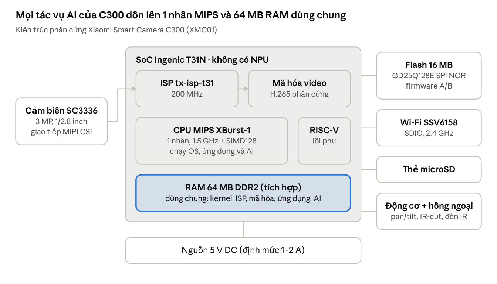

# Nghiên cứu thuật toán và lựa chọn mô hình phát hiện đối tượng trên camera biên

**Học phần:** IT6017 — Xu hướng công nghệ trong chuyển đổi số (ĐHBKHN)  
**Đề tài:** Phát hiện người và phát hiện lửa trên camera AI biên  
**Thiết bị đích:** Xiaomi Smart Camera C300 (`XMC01` / `MJSXJ14CM`), SoC Ingenic T31N  
**Cơ sở phần cứng:** [Nghiên cứu phần cứng – Edge AI Object Detection bản mới.pdf](../Nghiên%20cứu%20phần%20cứng%20–%20Edge%20AI%20Object%20Detection%20bản%20mới.pdf) (21/10/2026)  
**Ngày:** 22/10/2026

Báo cáo này đề xuất thuật toán sẽ dùng trên C300 và cách so sánh các ứng viên. Ràng buộc lấy từ khảo sát phần cứng. Độ trễ, công suất, mAP trên tập đo, và việc chạy trên điện thoại hay T31N thuộc **phần thực nghiệm** — không trình bày ở đây. Phần thực nghiệm lấy lựa chọn ở mục 4 làm điểm xuất phát.

---

## 1. Ràng buộc phần cứng đối với thuật toán

Khảo sát phần cứng xác nhận C300 dùng một nhân MIPS32 XBurst-1 (danh định 1,5 GHz, đo khoảng 1,39 GHz), SIMD128, **không có NPU**. RAM 64 MB DDR2 dùng chung cho kernel, ISP, bộ mã hóa H.265, ứng dụng Xiaomi và AI. Flash SPI NOR 16 MB, sơ đồ A/B; mỗi bản ứng dụng `user_A` / `user_B` khoảng **5,56 MB** và phải chứa cả chương trình lẫn mô hình, trừ khi mô hình nạp từ thẻ microSD.

Cảm biến SmartSens SC3336 cho video 2304×1296, tối đa 30 fps. Mô hình chỉ nhận ảnh đã thu nhỏ. ISP `tx-isp-t31` và encoder H.265 là phần cứng; khảo sát không mô tả cổng DMA 320×320 với 0 ms CPU. Vỏ nhựa, không quạt, nguồn 5 V. Không có SDK AI công khai cho T31N; file `.tflite` trên máy khác không chạy nguyên trên camera. Secure boot chặn nạp firmware tự build.

**Hình 1.** Đường dữ liệu C300 theo khảo sát phần cứng: SC3336 → ISP → H.265 và CPU; 64 MB RAM dùng chung. Nguồn: PDF khảo sát 21/10/2026.

Điều kiện chọn mô hình:

1. File INT8 vài megabyte: vừa phần còn lại của `user_*`, hoặc nạp từ thẻ SD.
2. Bộ nhớ đỉnh (trọng số + activation) phải vừa RAM trống trên firmware đang chạy. Khảo sát chỉ ước lượng phần AI “vài MB đến vài chục MB”; số `free` chưa có — để phần thực nghiệm đo.
3. Mọi toán tử chạy trên một nhân MIPS + SIMD128.
4. Chạy theo sự kiện (khi có chuyển động), không cần suy luận mọi khung 30 fps.
5. Không dùng FP32 bền trên vỏ kín.

Wyze Cam v4 trong cùng PDF chỉ đối chiếu: T41 có NPU 1,2 TOPS INT8. Không phải thiết bị triển khai của đề tài.

---

## 2. Ứng viên và tiêu chí so sánh

Ba bộ dò: **YOLOv8n** (Nano, Ultralytics), **SSD MobileNetV2** (TensorFlow Detection Zoo), **EfficientDet-Lite0** (Google AutoML / LiteRT Model Maker). Cả ba weight COCO đều có lớp `person`. COCO không định nghĩa lớp lửa hay khói; không dùng lớp `fire hydrant` thay lửa.

Số đo độ trễ, công suất và mAP trên tập của nhóm thuộc phần thực nghiệm. Dưới đây chỉ dùng: (i) tài liệu hãng, (ii) kích thước và layout file `.tflite` trong `models/`, (iii) ràng buộc mục 1.

| Tiêu chí | Lấy từ đâu | Việc trên C300 |
|---|---|---|
| Kiến trúc, số lớp COCO, input mặc định | Tài liệu Ultralytics / TF / AutoML / MediaPipe | Một nhân SIMD, không NPU |
| mAP và latency **công bố** | Cùng nguồn; luôn kèm phần cứng và kích thước ảnh của họ | Chỉ định vị họ mô hình, không phải số T31N |
| Dung lượng file FP32 / INT8 | File trong `models/` (làm tròn 2 chữ số, đơn vị MiB) | Đối chiếu `user_*` ≈ 5,56 MB hoặc thẻ SD |
| Layout và kiểu I/O | Shape / dtype tensor của đúng file đó | NHWC + I/O nguyên dễ kernel nhúng hơn NCHW + FP32 |
| NMS / hậu xử lý | Cách export TFLite của từng họ | Op custom có thể phải viết lại bằng C trên MIPS |
| Giấy phép | Ultralytics AGPL-3.0; TensorFlow và AutoML Apache-2.0 | Ràng buộc pháp lý nếu đưa vào sản phẩm |

---

## 3. So sánh chi tiết

### 3.1 YOLOv8n (Nano)

Ultralytics mô tả YOLOv8 là detector **không neo**, dùng **split head** (phân loại và hồi quy box tách). Biến thể Nano (`n`) là bản nhỏ nhất trong bảng detection. Ultralytics không công bố bài báo kiến trúc; cấu hình chính thức `yolov8n.yaml` dùng khối C2f, SPPF và cổ FPN/PAN. Input khi công bố là **640×640**. File trong repo export **320×320**, layout **NCHW** (`1×3×320×320`). Script suy luận đọc output `[1, 84, 2100]` (4 tọa độ + 80 lớp).

Trên COCO val2017, đúng 640×640, bảng Ultralytics ghi YOLOv8n: **mAP50-95 = 37,3**, 3,2 triệu tham số, 8,7 BFLOPs; **80,4 ms** cột CPU ONNX và **0,99 ms** cột A100 TensorRT. Chú thích Hugging Face / docs: tốc độ trung bình trên ảnh COCO val, instance Amazon EC2 P4d. Đó không phải T31N. Ultralytics không công bố lại FLOPs hay mAP cho bản 320×320. Weight COCO **80 lớp**; `person` là lớp 0 (chuẩn COCO-80 và `EXPECTED_MATRIX_SPECS` trong `eval-model.py`).

Hai file trong `models/` (dung lượng = kích thước đĩa / 1024², làm tròn 2 chữ số):

- `yolov8n_320_fp32.tflite` — 12,17 MB, I/O FP32.
- `yolov8n_320_int8.tflite` — 3,31 MB. `test-live-camera.py` đặt tên **Weight INT8**: I/O vẫn FP32, NCHW. `eval-model.py` gán `WEIGHT_INT8` khi tỉ lệ tensor INT8 > 50% nhưng dtype đầu vào không phải uint8/int8. File này chưa phải static INT8 (activation I/O còn FP32).

Giấy phép: AGPL-3.0 hoặc Enterprise. Fine-tune một head sang `{person, fire, smoke}` không đổi họ kiến trúc; repo chưa có weight lửa.

### 3.2 SSD MobileNetV2

SSD gắn neo lên nhiều feature map; backbone MobileNetV2 dùng convolution tách theo chiều sâu. File trong repo: **300×300, NHWC** (`1×300×300×3`), **90 lớp** theo spec `eval-model.py`. Id `person` trên file SSD không thống nhất giữa các export: spec ghi `human_class_id = 0`; `eval_accuracy_map.py` ghi zoo TF thường dùng 1 và chấp nhận cả 0 lẫn 1.

TF1 Detection Zoo: `ssd_mobilenet_v2_coco` **COCO mAP = 22** (làm tròn số nguyên, protocol MSCOCO trên tập con validation COCO 14); `ssd_mobilenet_v2_quantized_coco` cũng **22**. Cột tốc độ: **31 ms** (float) / **29 ms** (quantized), **ms/ảnh 600×600 gồm pre/post**, đo trên **Nvidia GeForce GTX TITAN X**. Zoo cảnh báo GPU desktop không phản ánh mobile. Checkpoint lượng tử 300×300 trên zoo không đồng nhất với file `.tflite` của nhóm.

Blog TensorFlow (16/6/2021) và TF2 zoo có **SSD MobileNetV2 320×320** khác: INT8 **6,7 MB**, **20,2%** mAP COCO 2017, **24 ms** Pixel 4 **4 luồng CPU** (blog); TF2 zoo ghi **19 ms** / 20,2 mAP cho checkpoint 320×320. File nhóm là 300×300, 5,93 MB INT8 — không lấy số 320×320 làm số của file này.

Hai file trong `models/`:

- `ssd_mobilenet_v2_fp32.tflite` — 23,24 MB, I/O FP32.
- `ssd_mobilenet_v2_int8.tflite` — 5,93 MB, I/O uint8. `eval-model.py` xếp **FULL_INT8** khi đầu vào uint8/int8 và tỉ lệ tensor INT8 > 50%.

Script đọc bốn tensor boxes / classes / scores / count — đúng kiểu export có op `TFLite_Detection_PostProcess`. Op này không phải conv; runtime MIPS tối giản có thể không có kernel sẵn. Giấy phép dòng TensorFlow: Apache-2.0.

5,93 MB > một slot `user_*` (5,56 MB): nếu chọn SSD thì nạp từ microSD, không nhét cùng app vào NOR.

### 3.3 EfficientDet-Lite0

MediaPipe Object Detector: EfficientDet-Lite0 dùng backbone **EfficientNet-Lite0**, input **320×320**, mạng đặc trưng **BiFPN**. Lite0 là bản nhỏ nhất họ Lite (Lite0–Lite4 trên blog TF / Model Maker).

LiteRT Model Maker và blog TF 16/6/2021, bản INT8: **4,4 MB**, **25,69%** mAP COCO 2017 val, **37 ms** CPU Pixel 4 **4 luồng**. README google/automl, EfficientDet-lite0: mAP float **26,41**, INT8 **26,10**, 3,2 triệu tham số; cột “Mobile latency” **36 ms** (không ghi SoC). MediaPipe: INT8 **29,31 ms** CPU Pixel 6 (bảng task benchmark). Không số nào là T31N. Hai cột mAP (25,69% Model Maker vs 26,41/26,10 AutoML) là hai bảng khác nhau, không gộp thành một số.

Hai file trong `models/`:

- `efficientdet_lite0_fp32.tflite` — 13,20 MB, 320×320 NHWC, I/O FP32.
- `efficientdet_lite0_int8.tflite` — 4,39 MB, 320×320 NHWC, I/O uint8 (gần 4,4 MB công bố). Spec: 90 lớp, `human_class_id = 1`.

Khác với SSD, decoder trong `eval_accuracy_map.py` / `test-live-camera.py` đọc tensor score + delta rồi giải neo bằng `EfficientDetAnchorGenerator` — file nhóm không đi qua bốn output NMS sẵn. Export Model Maker chuẩn thì gắn op NMS custom; source Model Maker ghi op này không lượng tử được nên `inference_output_type=None` (output NMS float). Không suy ra file nhóm có hoặc không có đúng op đó chỉ từ dung lượng.

BiFPN giữ và trộn nhiều thang feature cùng lúc. Trên 64 MB DDR2 dùng chung ISP/encoder, đây là rủi RAM **về kiến trúc**; chưa có số `rss` trên C300. Giấy phép Apache-2.0 / AutoML.

### 3.4 Bảng tổng hợp

Hàng “công bố” luôn kèm điều kiện đo. Không xếp hạng mAP giữa ba cột: khác kích thước ảnh, khác tập (val2017 / coco14 minival / COCO 2017), khác định nghĩa mAP. Hàng file là `models/` của nhóm.

| | YOLOv8n | SSD MobileNetV2 | EfficientDet-Lite0 |
|---|---|---|---|
| Họ | Ultralytics YOLO v8, Nano | SSD + MobileNetV2 | EfficientDet-Lite, bản 0 |
| Backbone / cổ | C2f, SPPF, FPN/PAN (`yolov8n.yaml`) | Depthwise MobileNetV2 | EfficientNet-Lite0 + BiFPN (MediaPipe) |
| Neo | Không (anchor-free split head) | Có | Có (decoder neo trong script nhóm) |
| Input công bố | 640×640 | Zoo TF1: 300×300; blog/TF2: còn bản 320×320 | 320×320 |
| Input file nhóm | 320×320 NCHW | 300×300 NHWC | 320×320 NHWC |
| Lớp (spec repo) | 80; `person` = 0 | 90; spec `person` = 0 (code cũng chấp nhận 1) | 90; spec `person` = 1 |
| mAP công bố | 37,3 mAP50-95, COCO val2017, **640** | Zoo TF1: 22 (float và quantized, làm tròn); blog: 20,2% bản **320 INT8** | Model Maker INT8: 25,69% COCO 2017; AutoML: 26,41 / 26,10 |
| Latency công bố | 80,4 ms CPU ONNX; 0,99 ms A100 (P4d) | 31 / 29 ms TITAN X, ảnh 600×600; 24 ms Pixel 4 4T (bản 320) | 37 ms Pixel 4 4T; 29,31 ms Pixel 6 CPU INT8 |
| File FP32 / INT8 | 12,17 / 3,31 MB | 23,24 / 5,93 MB | 13,20 / 4,39 MB |
| I/O file INT8 | FP32 (Weight INT8) | uint8 (FULL_INT8 theo `eval-model.py`) | uint8 (FULL_INT8 theo `eval-model.py`) |
| Vừa `user_*` 5,56 MB? | INT8: có (3,31). FP32: không | INT8: không (5,93). FP32: không | INT8: có nếu app còn chỗ (4,39). FP32: không |
| Hậu xử lý file nhóm | Tensor thô `[1,84,2100]`, NMS host | Bốn tensor boxes/classes/scores/count | Score + delta + neo trong script |
| Lửa | Fine-tune 1 head; COCO không có lửa | Cùng hạn chế; INT8 đã vượt flash app | Cùng hạn chế; BiFPN bất lợi RAM |
| Giấy phép | AGPL-3.0 / Enterprise | Apache-2.0 | Apache-2.0 |

### 3.5 Đối chiếu ràng buộc C300 (không phải kết quả đo)

- **Flash.** Chỉ YOLOv8n INT8 (3,31 MB) chắc chắn nhỏ hơn một mình slot `user_*`. EfficientDet INT8 (4,39 MB) còn phụ thuộc chỗ trống của app. SSD INT8 và mọi FP32 không nằm trong NOR cùng ứng dụng; SSD INT8 chỉ còn đường thẻ SD.
- **Tính toán.** Cả ba đều conv 2D; SSD thiên depthwise; YOLO có upsample FPN; EfficientDet có BiFPN lặp. Không có NPU — không dùng latency Pixel/A100/TITAN X làm FPS camera.
- **Lượng tử.** SSD và EfficientDet trong repo đã I/O nguyên. YOLO INT8 trong repo vẫn I/O FP32: khớp SIMD INT8 trên T31N đòi hỏi export static INT8 (phần triển khai), không đổi việc chọn Nano thay vì Medium/640.
- **Hai mạng người + lửa.** Repo chưa có weight lửa. Nếu chạy hai mạng, dù file thứ hai chỉ bằng YOLO INT8 (3,31 + 3,31 MB) đã vượt 5,56 MB. Một head ba lớp trên cùng YOLOv8n không đổi họ kiến trúc.

Không suy ra mô hình nào “thắng FPS” trên T31N từ bảng công bố. Điều đó để phần thực nghiệm.

---

## 4. Lựa chọn

**Mô hình chính:** YOLOv8n, ảnh vào 320×320. Lý do: file INT8 nhỏ nhất so với `user_*`, kiến trúc một head dễ thêm lửa, không phụ thuộc NPU. Không chọn vì đã “đạt 20 FPS trên C300” — điều đó do phần thực nghiệm trả lời.

**Định dạng trên testbed:** TFLite/LiteRT. Trên C300: TFLite-Micro cross-compile MIPS, hoặc Magik nếu có bản T31 nội bộ (bản công khai hiện nhắm T41/NPU).

**Lượng tử:** mục tiêu nạp camera là static INT8 (weight và activation nguyên). File `models/yolov8n_320_int8.tflite` là Weight-INT8, dùng như bản trao đổi cho đến khi có export full-integer.

**Runtime:** một luồng XBurst-1 + SIMD128.

**Dự phòng:** SSD MobileNetV2 INT8 nếu YOLO không biên dịch được trên MIPS. Nạp SD (5,93 MB > 5,56 MB); NMS custom có thể phải viết bằng C.

**Không dùng:** EfficientDet-Lite0; mọi FP32; YOLO 640×640; hai mạng người + lửa song song (hai file INT8 đã vượt phần dư `user_*`).

**Người và lửa.** Weight COCO không phát hiện lửa. Giữ một YOLOv8n, fine-tune `{person, fire, smoke}`, rồi lượng tử INT8. Khói đánh giá theo tỉ lệ bắt được và số báo nhầm mỗi giờ, không chỉ mAP IoU. Tập phải có ảnh đúng ống kính C300, kể cả IR đêm.

**Pipeline đề xuất** (để phần thực nghiệm bám cùng thứ tự):

1. Cảm biến → ISP; H.265 encode trên phần cứng. AI chỉ chạy khi có chuyển động.
2. Lấy buffer ISP đã thu nhỏ. Không letterbox 2K trên nhân MIPS.
3. Suy luận INT8, một luồng. Nạp weight từ phần dư `user_*` hoặc thẻ SD.
4. Giải box; ngưỡng tin cậy và IoU NMS lấy theo cấu hình từng mô hình, chỉnh trên tập đo (phần thực nghiệm).
5. Ra `{class, score, x1,y1,x2,y2}`. Người: bền vài khung rồi mới sự kiện / PTZ. Lửa: bền lâu hơn.

---

## 5. Kết luận

Trên ràng buộc T31N (một nhân, không NPU, 64 MB RAM dùng chung, flash ứng dụng ~5,56 MB), thuật toán đưa vào so sánh thực nghiệm là **YOLOv8n 320×320**, lượng tử INT8, chạy một luồng SIMD128, theo sự kiện. SSD MobileNetV2 INT8 là dự phòng. EfficientDet-Lite0 và FP32 loại vì flash hoặc RAM. Lửa làm bằng một head ba lớp, sau nhánh người.

Phần thực nghiệm đo độ chính xác, độ trễ, RAM và công suất của đúng các lựa chọn trên — không chọn lại mô hình từ đầu.

---

## Tài liệu tham khảo

1. *Nghiên cứu phần cứng – Edge AI Object Detection bản mới*, 21/10/2026 — nguồn ràng buộc C300.  
2. thingino-firmware #1271 — teardown C300 (T31N, SC3336, SSV6158, flash A/B).  
3. Ultralytics, *YOLOv8* (bảng 640×640, mAP / CPU ONNX / A100, 80 lớp, AGPL-3.0), https://docs.ultralytics.com/models/yolov8.  
4. Ultralytics, *LiteRT export*, https://docs.ultralytics.com/integrations/litert.  
5. TensorFlow, *TF1 Detection Zoo* (`ssd_mobilenet_v2_coco` 31 ms / mAP 22; bản quantized 29 ms / 22; TITAN X, 600×600), https://github.com/tensorflow/models/blob/master/research/object_detection/g3doc/tf1_detection_zoo.md.  
6. TensorFlow Blog, 16/6/2021, *Easier object detection on mobile with TFLite* (EfficientDet-Lite0 INT8 4,4 MB / 37 ms Pixel 4 4T / 25,69%; SSD MobileNetV2 320 INT8 6,7 MB / 24 ms / 20,2%), https://blog.tensorflow.org/2021/06/easier-object-detection-on-mobile-with-tf-lite.html.  
7. LiteRT Model Maker, *Object detection* (cùng bảng Lite0; mặc định full-integer PTQ), https://developers.google.com/edge/litert/libraries/modify/object_detection.  
8. Google AutoML, *EfficientDet README* (lite0: 26,41 / 26,10 mAP, 3,2M, 36 ms), https://github.com/google/automl/blob/master/efficientdet/README.md.  
9. MediaPipe, *Object detector* (Lite0: EfficientNet-Lite0 + BiFPN 320×320; INT8 29,31 ms CPU Pixel 6), https://developers.google.com/edge/mediapipe/solutions/vision/object_detector.  
10. TensorFlow Examples, `object_detector_spec.py` — NMS custom TFLite không lượng tử, output float.  
11. LiteRT, *Post-training quantization*.  
12. Ingenic, T31, http://www.ingenic.com.cn/products-detail/id-21.html.  
13. Ultralytics #3582 — YOLO COCO không có lớp lửa.  
14. File `models/*.tflite` và spec `EXPECTED_MATRIX_SPECS` trong `scripts/eval-model.py` — kích thước, layout, dtype, số lớp.
